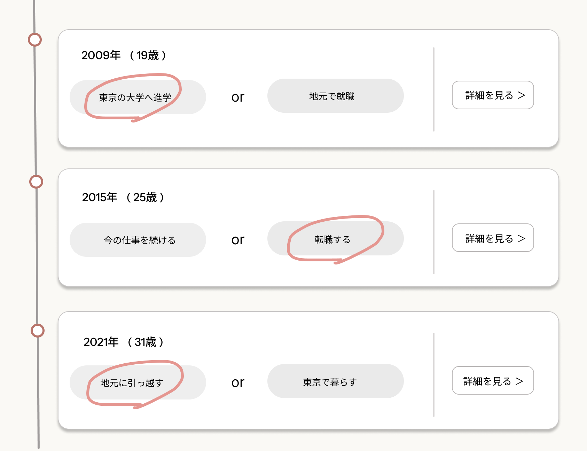

## 1. アプリの概要

### アプリの名前

**「岐路録（きろろく）」**

### どんなサービスか

**「話したいけど話せない」から「これが私の岐路録です！」へ!**

「岐路録（きろろく）」は、人生の岐路で**選んだ道**と**選ばなかった道**を記録・公開できる、**新しい形の自己紹介サービス**です。

人生の中で何を選び、何と迷い、なぜその道を選んだのか。

自分の歩んできた道を視覚的にまとめることで、その人の経験や価値観を知ることができます。

- すべてを言葉で説明するのではなく、自分の人生を見える形にして伝える。
- 全部を話さなくても、自分らしさが伝わる。
- 自分の経験や価値観を、自分から相手に伝えるきっかけになる。

そして、そこから新しい会話が生まれることを目指しています。

---

## 2. このアイデアが生まれたきっかけ

### 2-1. きっかけとなった体験

新しい環境で自己紹介をする際、これまでの人生経験の中から、何を選んで話せばよいのか迷うことがありました。

自分の経験を知ってもらいたい気持ちはあるものの、話が長くなってしまうことや、相手がすべてを聞きたいとは限らないことに、不安を感じていました。

同年代の友人に自己紹介の難しさを相談したところ、話を短くまとめても、その人らしさが十分に伝わらないことや、聞く側も退屈してしまう場合があるという意見も聞くことができました。

私自身、過去にプログラミングを深く学ぶことと、妊活に専念することの間で選択をした経験があります。
当時は妊活を優先しましたが、プログラミングへの興味がなくなったわけではありませんでした。
その思いは残り続け、現在はエンジニアを目指して学習しています。

この経験から、人生には選んだ道だけでなく、**そのとき選ばなかった道にも、その人の思いや価値観が表れている**と考えるようになりました。

選んだ結果だけを伝えるのではなく、当時どのような選択肢があり、なぜその道を選んだのかを視覚的に表現できれば、今の自分に至るまでの背景も伝えやすくなるのではないかと考えました。

そこで、人生の岐路をカード形式で記録し、URLなどを通じて相手に共有できる自己紹介アプリを考案しました。

相手は自分の都合のよい時間に閲覧でき、興味を持った出来事から自然に会話が始まる。

そんな自己紹介の方法があってもよいのではないかと考えたことが、開発のきっかけです。

---

### 2-2. なぜそれが「気になった」のか

**自分の性格**

自分の話をする際、相手の気持ちや時間を気にしてしまい、負担になっていないか考える傾向があります。

**過去の経験**

昔から身近な人に「説明が下手」「何を言いたいのかわからない」と言われることがあり、自分の話を伝えることに自信が持てませんでした。

また、自分の経験を話す際には、出来事だけでなく、その背景や当時の気持ちまで伝えようとして、話が長くなってしまうことがありました。

**大切にしている価値観**

私は、相手の立場に立ち、必要な情報をわかりやすく伝えることを大切にしています。

相手の年齢や理解度に合わせて、言葉だけでなく、視覚的な表現を工夫することも大切だと考えています。

だからこそ、自分のことを知ってもらいたい気持ちと、相手に負担をかけたくない気持ちの両方を大切にできる方法を考えたいと思いました。

---

## 3. 課題の整理

### 3-1. 表に見えている困りごと

**話す側の困りごと**

- 自己紹介で何から、どこまで話せばよいかわからない。
- 自分の経験や背景を短い言葉で伝えることが難しい。
- 話が長くなることで、相手を退屈させてしまうのではないかと不安になる。

**聞く側の困りごと**

- 相手のことをもっと知りたくても、何を質問すればよいかわからない。
- 興味はあっても、踏み込んで聞いてよい話題なのか判断できない。
- 短い自己紹介だけでは、その人の経験や価値観が十分にわからない。

---

### 3-2. 本当に解決したい課題は何か

話す側と聞く側の双方が、相手への気遣いや遠慮によって、お互いを知るきっかけを逃してしまうことです。

---

### 3-3. 課題で実現したいこと

人生の岐路で選んだ道だけでなく、選ばなかった道やその理由も可視化し、経歴だけでは見えない、その人の考え方や価値観を伝えやすくします。

相手が興味を持った出来事から自然に会話が生まれ、少しずつお互いを知っていけるような、自己紹介の入口となるサービスを目指します。

---

## 4. 想定ユーザーについて

### 4-1. 想定しているユーザー

**年齢設定**

- **年齢** ：40代（開発者自身）
- **理由** ：まずは自分自身で利用し、同じ悩みに共感してくれた同級生にも使ってもらいたいと考えています。将来的には年齢を問わず、同じ課題を持つ人を対象とします。

**想定するユーザー**

- 人生の選択や、その背景にある思いを記録したい人
- 自分の経験や人となりを相手に伝えたい人
- 相手の経験に興味があっても、なかなか質問できない人

**生活・状況設定**

- **生活・状況** ：仕事や家庭生活と並行して新しい挑戦を続け、職場やスクールなどで初対面の人と出会う機会がある。
- **理由** ：限られた自己紹介の時間では伝えきれない経験や背景を、相手の都合に合わせて共有できるため。

---

### 4-2. 自分とユーザーの距離

**選んだもの** ：自分自身

**なぜその距離感なのか** ：自分自身が、相手の反応や時間を気にして、経験や思いを十分に伝えられなかったことが開発の出発点だからです。
まずは自分が実際に使い、課題を解決できるアプリを目指します。

---

### 4-3. 実際に使われる可能性について

**まず最初に使ってくれそうな人** ：自分自身

**使ってもらいたい人は誰か？** ：年齢を問わず、自分の経験や価値観を相手に伝えることに難しさを感じている方。

**その人は、どんな場面でこのアプリを思い出すか？** ：新しい職場やスクールなど、初対面の人と自己紹介をする場面。

**今の生活の中で、代わりに使っているものは何か？** ：雑談、履歴書、SNSのプロフィール、名刺。

**それを置き換えてまで使う理由はあるか？** ：従来の自己紹介を置き換えるのではなく、補完するサービスとして利用してもらうことを想定しています。

- **経験の背景を伝えられる** ：選んだ道だけでなく、選ばなかった道やその理由も示せる。
- **繰り返し共有できる** ：公開URLを名刺感覚で共有し、相手のタイミングで閲覧してもらえる。
- **他人の評価を気にせず記録できる** ：コメント・いいね・閲覧数などの機能を設けない。

---

## 4-4. ユーザーがサービスを導入して利用するまでのイメージ(導入・継続の流れ)

**どんな場面・困りごとがきっかけで、このサービスを知る・思い出すか**

- 新しい職場、コミュニティで、限られた自己紹介の時間では、自分の経験や選択の背景まで十分に伝えきれない時。
- 自己紹介では話しきれなかった経験や思いを、相手に知ってもらいたい時。

**最初の一歩（登録・導入）で、ユーザーは何をする必要があるか**

1. **ユーザー登録** ：メールアドレスとパスワードでアカウントを作成する。
2. **岐路録カード作成** ：人生の岐路、「選んだ道・選ばなかった道・詳細(選択理由など)」を記入する。
3. **岐路カードの管理** ：作成したカードを一覧で確認し、編集・削除できる。
4. **岐路録の公開・共有** ：相手に見せたい岐路を選び、公開ページのURLを自己紹介などの場面で共有する。

- 公開ページは、ユーザー登録していない人も閲覧できる。

5. **閲覧** ：共有された相手は、好きなタイミングで岐路カードの一覧を閲覧し、興味を持ったカードの「詳細を見る」から、選択した理由や当時の思いなどを詳しく知ることができる。

**利用を続ける理由は何か？**

- 新たな人生の岐路を迎えるたびにカードを追加し、自分の歩みを更新できる。
- 過去の選択を振り返り、自分の価値観や考え方の変化を確認できる。
- 新しく出会う人に公開ページを共有し、自己紹介のきっかけとして繰り返し利用できる。

---

## 5. 既存サービス・競合調査

### 5-1. 似たサービスの調査

- サービス名 ：LifeBook Maker
- URL：https://lifebookmaker.com/
- どんなことができるか ：人生の出来事を振り返り、自分史として記録するサービス。

- サービス名：Profiee
- URL：https://profiee.com/
- どんなことができるか ：活動やプロフィールの紹介が中心のサービス。

---

### 5-2. それでも自分が作りたい理由

**既存サービスがある中で、**

1. **なぜ満足できなかったのか**

- 経歴やプロフィールをまとめるサービスでは、選ばなかった道や当時の思いまで表現しにくい。
- SNSでは、日常の出来事や現在の活動は共有できても、人生の選択の背景までは伝わりにくい。
- 自分から話しにくい経験や思いを、相手に知ってもらうための方法が欲しかった。

2. **どこに違和感があったのか**

- 自己紹介が「何をしてきたか」という結果中心になり、「なぜその道を選んだのか」が見えにくいこと。
- 相手のことを深く知るには、本人に詳しく質問する必要があること。
- SNSでは、自己表現が「いいね」や閲覧数などの評価と結びつきやすいこと。

---

### 5-3. 差別化を「体験価値」で表現する

**このアプリは、【どんな人】の【どんな瞬間】を一番助けるアプリですか？**

自分の経験や思いを相手に伝えたいけれど、何をどう話せばよいか迷ってしまう人が、初対面の相手に自分を知ってもらいたいときに役立つアプリです。

**アプリの差別化ポイント**

- **選んだ道と選ばなかった道を対比できる** ：人生の帰路には複数の選択肢が存在するが、最終的に大きく二つの道の間で悩み、決断することもある。二つの道を対比させることで、経歴や結果だけでは見えない、その人の価値観や選択の背景を直感的に伝えられる。
- **自分のペースで伝えられる** ：公開URLを共有し、相手の都合に合わせて閲覧してもらえる。
- **評価を目的としない** ：コメント・いいね・閲覧数などを設けず、他人の評価を気にせず記録・共有できる。
- **会話の入口になる** ：興味を持った出来事から、自然に会話が始まるきっかけを作る。

---

## 6. このサービスで提供したい価値

### 6-1. ユーザーの変化

このサービスを使うことで、ユーザーはどう変化しますか？

**行動の変化**

- **自分を伝える一歩を踏み出せる**

  自分の経験や価値観を可視化し、相手に共有できるようになる。

**気持ちの変化**

- **自分の思いを形にできる**

  話しづらかった経験や思いを、自分なりの言葉で表現できる。

**考え方の変化**

- **自分の経験や選択を大切にできる**

  過去の選択を振り返り、自分が何を大切にしてきたのかに気づくきっかけになる。

---

### 6-2. 価値を一文で表す

自分の経験や価値観を、自分の意思で相手に伝えるきっかけを作れること。

---

## 7. このアプリで実現すること

### MVPでは、サービスの核となる以下の体験を実現します。

### MVPで作る機能

1. **ユーザー認証**

- ユーザー登録・ログイン・ログアウト

2. **岐路カードの作成**

- 年（西暦）・年齢の入力
- 選択Aと選択Bの入力
  (一つの岐路につき「選んだ道」と「選ばなかった道」をそれぞれ一つずつ登録できる仕様とする)
- どちらを選択したか
  (ラジオボタンで実際に選んだ道を一つ指定)
- 詳細記入
  (選択理由や当時の状況・思いなどの詳細入力)

```
[ 入力例 ]
- 年（西暦）：2009年
- 年齢：19歳
- 選んだ道：東京の大学へ進学
- 選ばなかった道：地元で就職
- 実際に選んだ道：選択肢A
- 詳細：新しい環境で学びたかったから。
```

3. **岐路カードの一覧・詳細表示**

- 二つの選択肢を左右に並べ、実際に選んだ道を手描き風の赤い楕円で囲んで表示する。
- 作成時のプレビュー・保存後の一覧・公開ページに選択結果を反映する。
- 各カードの「詳細を見る」をクリックすると、該当する岐路の詳細画面へ遷移する。
- 選択理由や当時の状況・思いなどは詳細画面に表示する。

一覧画面では表示する情報を絞り、スクロール量を抑える。閲覧者は興味を持った岐路だけを自分のペースで詳しく確認できる。

**岐路カード一覧画面**



※掲載画像は画面イメージの一部です。実際の表示は開発時に調整する場合があります。

4. **岐路カードの管理**

- 作成した岐路カードの編集・削除

5. **公開設定・共有**

- 岐路録ページ全体の公開・非公開設定
- 岐路カード単位の公開・非公開設定
- 公開ページでは、公開設定された岐路カードのみを表示する
- 公開ページのURL共有（未ログインでも閲覧可能）

**MVPで選択肢を二つに絞る理由**

複数の選択肢が存在するケースも想定していますが、MVPでは開発期間と実装範囲を考慮し、まずは二つの選択肢の登録・選択・表示という基本機能を確実に完成させることを優先します。

---

### 本リリースで実装を検討する機能

- ゲスト体験機能（ユーザー登録せずに試す）
- QRコード生成
- タグ機能（岐路カードへのタグ付け）
- タグによる公開岐路録の検索・一覧表示
- 岐路カードの表示順切り替え（古い順・新しい順）
- 他ユーザーの岐路録のブックマーク登録
- 「選ばなかった道」を複数登録
  - 「選ばなかった道」を追加し、一つの岐路に複数の選択肢を登録できる機能

---

### 将来的に追加したい機能

ドラッグ＆ドロップによる岐路カードの自由な並び替え

---

## 8. このアプリの懸念点とその対策

### 懸念点1：センシティブな情報の取り扱い

- **何が問題になりそうか** ：人生の岐路には、家庭環境や病気、仕事など、他人に知られたくない情報が含まれる可能性がある。

- **なぜそう思うか** ：人生経験の中には、自分から話しにくいことや、相手によっては伝えたくないこともあるため。

- **そのために考えている対策** ：岐路録ページ全体とカード単位でのの公開・非公開を設定できるようにし、公開前に内容を確認できるようにする。コメントやリアクション機能を設けず、アプリ内で他者から評価される仕組みを設けない。そして、公開ページに noindex を設定し、検索エンジンの検索結果に表示されないようにする。

### 懸念点2：利用頻度が低くなる可能性

- **何が問題になりそうか** ：新しい岐路を記録する機会が少なく、アプリを使わなくなる可能性がある。
- **なぜそう思うか** ：人生の大きな選択は頻繁に起こるものではないため。
- **そのために考えている対策** ：毎日の利用を促すのではなく、新しい人生の選択をしたときに、気軽に記録を追加・更新できるようにする。作成した岐路録をURLで繰り返し共有できるようにし、新しい出会いの場でも活用してもらう。

---

## 9. 今後の展開・発展の方向性

### 観点

**ユーザーはなぜ使い続ける？**
新たな人生の岐路を迎えた際に記録を追加でき、自己紹介の場でも繰り返し活用できるため。

**続けることで何が変わる？**
過去の選択を振り返ることで、自分の価値観や考え方の変化に気づき、それを相手にも伝えやすくなる。

**データが溜まると何ができる？**
関連する岐路同士を線で結ぶ「岐路マップ」により、過去の選択が現在の自分にどうつながっているのかを可視化できるようにする。

**他の人と関わる余地はある？**
タグ検索やブックマークを通じて、他のユーザーが公開した岐路録を閲覧できるようにする。ただし、アプリ内での交流機能は設けない。

**運用・仕組みで価値を出せないか？**

- 半年に一度など、定期的に「新しい岐路はありましたか？」と振り返りを促す仕組みを検討する。
- 岐路カードの作成画面で質問や入力例を表示し、自分の経験や選択理由を整理しながら記録できるようにする。

---

### 今考えている発展案

**機能追加の方向性**

- 関連する岐路同士のつながりを可視化する「岐路マップ」の実装。
- 岐路カードをテーマ別に分類し、公開する内容を選べる機能。
- 特に伝えたい岐路カードを優先表示する機能

**UI・体験の改善**

- 選択肢や選択理由を段階的に入力できる仕組み。
- 自己紹介の目的に合わせて、岐路カードを見やすく表示する工夫。

**機能以外の工夫**

- 記録しやすいよう、入力例やガイドを用意する。
- 新たな岐路を迎えた際に、無理なく更新できる利用方法を案内する。

---

## 10. 技術スタック（手段としての技術）

### 10-1. 使用予定の技術

| 項目                     | 技術・ライブラリ        | 用途                                                         |
| ------------------------ | ----------------------- | ------------------------------------------------------------ |
| バックエンド             | Ruby on Rails 8系       | アプリケーション開発・CRUD処理                               |
| フロントエンド           | Hotwire / JavaScript    | 画面の動的な更新・操作                                       |
| CSS/UI                   | Tailwind CSS            | 画面デザイン・レスポンシブ対応                               |
| DB                       | PostgreSQL              | データの保存・管理                                           |
| デプロイ先               | Render                  | アプリの公開・運用                                           |
| 開発環境                 | Docker / Docker Compose | 開発環境の構築・統一                                         |
| 認証機能                 | Sorcery                 | ログイン・ログアウト                                         |
| テスト                   | RSpec                   | 自動テスト                                                   |
| 公開状態管理             | enum（Rails標準機能）   | 岐路録ページ全体および岐路カード単位の公開・非公開状態の管理 |
| 検索エンジンへの掲載制御 | noindex                 | 公開ページが検索結果に掲載されるリスクを軽減                 |

---

### 10-2. 技術選定の比較検討

| 候補                | 採用/不採用 | 理由                                                       |
| ------------------- | ----------- | ---------------------------------------------------------- |
| Ruby/Ruby on Rails8 | 採用        | 学習経験があり、CRUDなどの機能を実装するため               |
| Tailwind CSS        | 採用        | 岐路録独自のカードUIを柔軟にデザインするため               |
| PostgreSQL          | 採用        | Railsと組み合わせて利用でき、Renderでも使用できるため      |
| Render              | 採用        | 比較的デプロイに取り組みやすいと判断したため               |
| Sorcery             | 採用        | 学習経験を活かして認証機能を実装できるため                 |
| React               | 不採用      | 学習で触れたことはありますが、追加の学習に時間がかかるため |

**今回チャレンジしたい点**

- これまで使用経験のないTailwind CSSを学習しながら、岐路録独自のUIを実装すること。

**不安な点**

- Tailwind CSSは未経験のため、学習と実装を並行して進められるか不安がある。

---

### 10-3. キャッチアップ不足の懸念

キャッチアップ不足の段階では以下の懸念点があります。

**Issueの見積もりが難しい**
Tailwind CSSなど未経験の技術については、実装に必要な作業量を把握しきれず、Issueの工数見積もりが難しいと感じています。
調査や学習にかかる時間も考慮しながら、開発を進めたいと考えています。

---

### 11. 画面遷移図

https://www.figma.com/design/Cbhz9st4tU2Hcxf44069hu/kiroroku?node-id=0-1&t=78PDBRmWHZ9SO64C-1

---

### 12. ER図

[]

---
